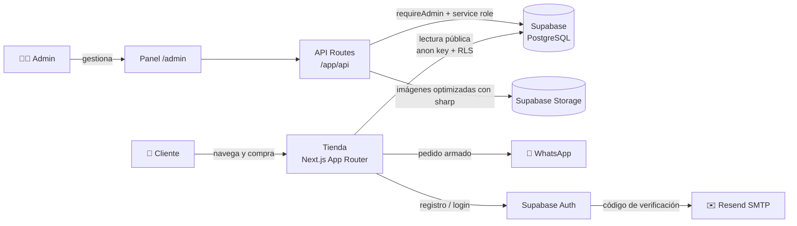

<h1 align="center">🛍 Guland — E-commerce de ropa urbana</h1>

<p align="center">
  Tienda online a medida para una marca de streetwear de Villa del Rosario, Córdoba.<br/>
  <b>En producción</b> y con ventas a todo el país.
</p>

<p align="center">
  <a href="https://www.guland.com.ar"></a>
</p>

<p align="center">
  
  
  
  
  
  
  
  
</p>

<!-- Reemplazá por una captura o mockup de la home: docs/preview.png -->
<p align="center">
  
</p>

---

## 📋 Índice

- [Descripción](#-descripción)
- [Funcionalidades](#-funcionalidades)
- [Arquitectura](#-arquitectura)
- [Estructura del proyecto](#-estructura-del-proyecto)
- [Modelo de datos](#-modelo-de-datos)
- [Seguridad](#-seguridad)
- [Cómo correrlo](#-cómo-correrlo)
- [Deploy](#-deploy)
- [Autor](#-autor)

---

## 📖 Descripción

Guland es una tienda online desarrollada **a medida** (sin plataformas tipo Tiendanube o Shopify) para una marca de ropa urbana unisex. Incluye la tienda pública y un **panel de administración** completo para que la dueña gestione productos, stock, pedidos, envíos y finanzas sin depender de un desarrollador.

La compra se cierra por **WhatsApp**: el cliente arma el carrito, completa sus datos y la app genera un mensaje con el detalle del pedido para coordinar el pago y el envío.

---

## ✨ Funcionalidades

### 🛒 Tienda
- Catálogo por categorías, con secciones de **lanzamientos (New Drops)** y **destacados**
- Filtros por talle y navegación por categoría
- **Stock por talle**: los talles agotados se deshabilitan y los productos sin stock se ocultan
- Guía de talles por producto
- Carrito persistente con **límite de stock**
- **Envío gratis dinámico** a partir de un monto configurable
- Costos de envío por **zona y código postal** (a domicilio o a sucursal), y opción de retiro en el local
- Descuento configurable por pago en efectivo o transferencia
- Finalización del pedido por **WhatsApp**, con el detalle generado automáticamente
- Registro y login de clientes con **verificación por código al email**
- Diseño **responsive**, adaptado a celular y compu

### 🧑‍💼 Panel de administración (`/admin`)
| Sección | Qué permite |
|---|---|
| **Dashboard** | Ingresos reales y ventas por categoría |
| **Productos** | Alta, edición y baja, con stock por talle e imágenes optimizadas automáticamente |
| **Pedidos** | Seguimiento y cambio de estado |
| **Ventas y Finanzas** | Registro de ventas (descuentan stock) y gastos |
| **Usuarios** | Listado de clientes registrados |
| **Configuración** | Número de WhatsApp, envío gratis, descuentos, zonas y códigos postales |
| **Ayuda** | Gestión de las preguntas frecuentes de la tienda |

---

## 🏗 Arquitectura



**Decisiones clave:**
- **Lecturas públicas** (productos, categorías, configuración) se hacen con la *anon key* y están limitadas por **Row Level Security**.
- **Todas las escrituras** pasan por *API Routes* del servidor, que validan que el usuario sea admin (`requireAdmin()`) y recién ahí usan la *service role key*. La clave privada nunca llega al navegador.
- El **middleware** protege `/admin` y `/cuenta` antes de renderizar.
- Las imágenes se convierten a **WebP** y se redimensionan al subirlas, para que la tienda cargue rápido.
- La home usa **ISR** (regeneración incremental) para servir páginas estáticas con datos actualizados.

---

## 📁 Estructura del proyecto

```
guland/
├── app/
│   ├── (store)/          # Tienda pública: home, shop, producto, carrito, cuenta, ayuda
│   ├── admin/            # Panel de administración
│   ├── api/              # API Routes (escrituras protegidas con requireAdmin)
│   └── auth/callback/    # Confirmación de cuenta
├── components/           # Componentes por área: cart, home, product, shop, admin, ui
├── lib/
│   ├── supabase/         # Clientes de Supabase (browser, server, admin) y requireAdmin
│   ├── shipping.ts       # Cálculo de envíos por zona y código postal
│   └── *-store.ts        # Estado global con Zustand (carrito, configuración, etc.)
├── supabase/
│   ├── schema.sql        # Esquema base
│   └── migrations/       # Migraciones incrementales (stock, envíos, RLS)
├── types/                # Tipos de TypeScript
└── middleware.ts         # Protección de rutas
```

---

## 🗄 Modelo de datos

| Tabla | Contenido |
|---|---|
| `profiles` | Datos del usuario y rol (`is_admin`) |
| `categories` / `products` | Catálogo, imágenes, talles y stock |
| `orders` / `order_items` | Pedidos y su detalle |
| `sales` / `expenses` | Ventas registradas y gastos del negocio |
| `store_settings` | Configuración general (WhatsApp, envío gratis, descuentos) |
| `shipping_zones` / `shipping_postal_codes` | Costos de envío por zona y código postal |
| `faq_categories` / `faq_items` | Preguntas frecuentes |

---

## 🔐 Seguridad

- **Row Level Security** activado en todas las tablas: cada cliente ve solo sus pedidos y su perfil; ventas, gastos y pedidos ajenos solo los ve el admin.
- Los usuarios **no pueden modificar su propio rol** ni crear pedidos directamente contra la base.
- Rutas de la API protegidas por rol de administrador, verificado en el servidor.
- Redirecciones del login limitadas a rutas internas (sin *open redirect*).
- Buckets de imágenes sin listado público.
- Headers de seguridad: HSTS, `X-Frame-Options`, `X-Content-Type-Options`, `Referrer-Policy` y `Permissions-Policy`.
- Credenciales fuera del repositorio (`.env*` en `.gitignore`).

---

## 🚀 Cómo correrlo

### Requisitos
- [Node.js](https://nodejs.org/) 20 o superior
- Una cuenta gratuita en [Supabase](https://supabase.com/)

### 1. Clonar e instalar
```bash
git clone https://github.com/MatiasZampetti/Guland.git
cd Guland
npm install
```

### 2. Crear la base de datos
1. Creá un proyecto nuevo en Supabase.
2. En el **SQL Editor**, ejecutá `supabase/schema.sql`.
3. Después ejecutá, **en orden**, cada archivo de `supabase/migrations/`.

### 3. Variables de entorno
Creá un archivo `.env.local` en la raíz:
```env
NEXT_PUBLIC_SUPABASE_URL=https://TU-PROYECTO.supabase.co
NEXT_PUBLIC_SUPABASE_ANON_KEY=tu-anon-key
SUPABASE_SERVICE_ROLE_KEY=tu-service-role-key
```
Las tres están en Supabase → **Project Settings → API**.
> ⚠️ La `SUPABASE_SERVICE_ROLE_KEY` es privada: nunca la subas al repo ni la expongas en el frontend.

### 4. Cargar datos de prueba (opcional)
Con el servidor corriendo en desarrollo:
```bash
curl -X POST http://localhost:3000/api/seed
```
Carga categorías y productos de ejemplo. Esta ruta está deshabilitada en producción.

### 5. Levantar el proyecto
```bash
npm run dev
```
Abrí [http://localhost:3000](http://localhost:3000).

### 6. Crear un administrador
1. Registrate desde la tienda (`/cuenta/registro`).
2. En Supabase → **Table Editor → profiles**, poné `is_admin = true` en tu usuario.
3. Entrá a [http://localhost:3000/admin](http://localhost:3000/admin).

### Scripts disponibles
| Comando | Descripción |
|---|---|
| `npm run dev` | Servidor de desarrollo |
| `npm run build` | Build de producción |
| `npm run start` | Servir el build |
| `npm run lint` | Linter (ESLint) |

---

## ☁️ Deploy

Desplegado en **Vercel**, con deploy automático en cada push a `main`.

1. Importá el repositorio en [Vercel](https://vercel.com/).
2. Cargá las tres variables de entorno en **Settings → Environment Variables**.
3. En Supabase → **Authentication → URL Configuration**, configurá la *Site URL* con tu dominio y agregá `https://tu-dominio/auth/callback` en *Redirect URLs*.
4. Para que los mails de verificación lleguen a cualquier dirección, configurá un SMTP propio (por ejemplo, [Resend](https://resend.com/)) en **Authentication → Emails → SMTP Settings**.

---

## 👤 Autor

**Matías Zampetti** — Desarrollador de Software

[](https://matiaszampetti.vercel.app)
[](https://github.com/MatiasZampetti)
[](https://www.linkedin.com/in/TU-USUARIO)
